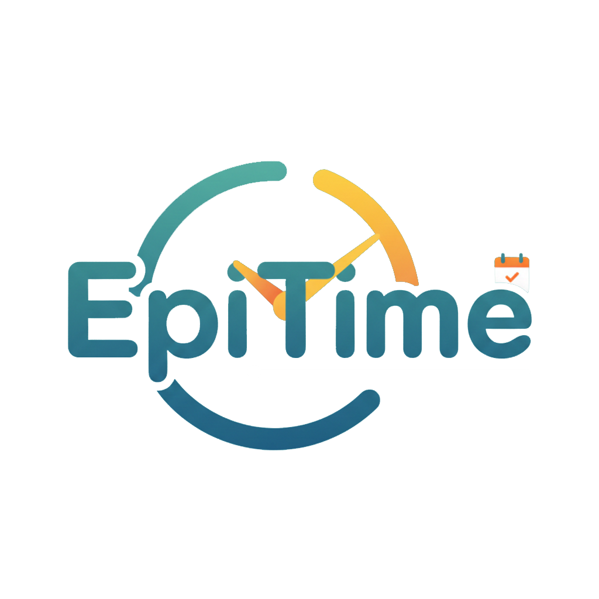
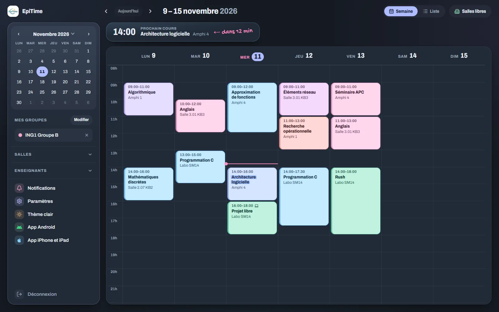
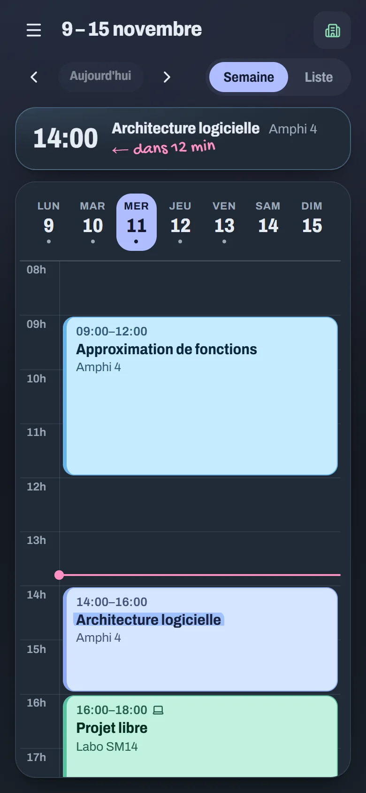
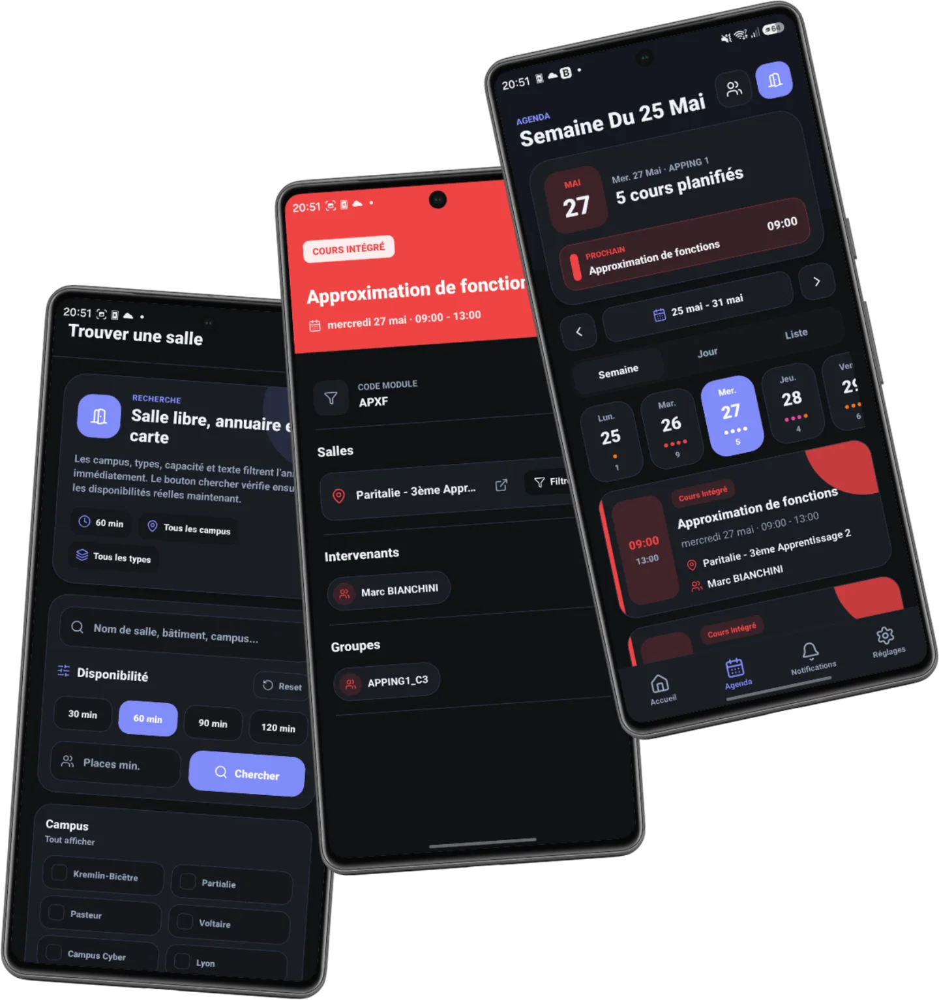

<div align="center">



# EpiTime

### Ton emploi du temps EPITA, enfin lisible.

Planning, salles libres, notes et rappels avant chaque cours, sur le web, Android, iPhone et iPad, et maintenant dans ton navigateur avec l'extension. Gratuit, open source, fait par un étudiant pour les étudiants.

<br />

<a href="https://epitime.epita.it">
  
</a>
<a href="https://apps.apple.com/fr/app/epitime/id6822687222">
  
</a>
<a href="https://github.com/alexistb2904/EpiTime/releases">
  
</a>
<a href="https://github.com/alexistb2904/EpiTime/releases">
  
</a>

<br /><br />

<a href="https://github.com/alexistb2904/EpiTime/stargazers">
  
</a>
<a href="https://github.com/alexistb2904/EpiTime/blob/main/LICENSE">
  
</a>


</div>

---

## Pourquoi EpiTime

Zeus et Auriga contiennent tout ce qu'il faut, mais leurs interfaces ne sont pas faites pour être ouvertes dix fois par jour sur un téléphone. EpiTime reprend les mêmes données et les range pour être lues d'un coup d'œil : où et quand est ton prochain cours, quelle salle est libre, quelle note vient de tomber.

- **Compréhensible en trois secondes** : le prochain cours est surligné, la salle et l'heure sont en gros.
- **Là où tu es** : navigateur, PWA, application Android, application iPhone et iPad, extension Chrome, Edge et Firefox.
- **Connexion simple** : ton compte Microsoft EPITA, rien d'autre. Aucun mot de passe n'est stocké.
- **Honnête** : open source (MIT), indépendant, mesure d'audience uniquement si tu l'acceptes.

---

## Aperçus

<div align="center">



<br /><br />




<sub>Captures avec des données d'exemple.</sub>

</div>

---

## Où utiliser EpiTime

| | Web et PWA | Android | iPhone et iPad | Extension |
| --- | :---: | :---: | :---: | :---: |
| Planning de la semaine | ✅ | ✅ | ✅ | |
| Prochain cours en un clic | ✅ | ✅ | ✅ | ✅ |
| Filtres groupe, salle et enseignant | ✅ | ✅ | ✅ | ✅ |
| Salles libres | ✅ | ✅ | ✅ | |
| Rappels avant les cours | ✅ | ✅ | ✅ | ✅ |
| Alertes de changement de salle ou d'horaire | ✅ | ✅ | ✅ | ✅ |
| Notes de cours | ✅ | ✅ | ✅ | ✅ |
| Notes et syllabus Auriga | | ✅ | ✅ | |
| Widgets d'écran d'accueil | | ✅ | | |
| Mode hors ligne | ✅ | ✅ | ✅ | ✅ |
| Sans installation | ✅ | | | |

| Plateforme | Où la trouver |
| --- | --- |
| Web et PWA | [epitime.epita.it](https://epitime.epita.it) |
| Android | APK dans les [releases GitHub](https://github.com/alexistb2904/EpiTime/releases) |
| iPhone et iPad | [App Store](https://apps.apple.com/fr/app/epitime/id6822687222) |
| Extension navigateur | [Releases GitHub](https://github.com/alexistb2904/EpiTime/releases), tags `x.x.x-extension` |

---

## Fonctionnalités

### Emploi du temps

- semaine en grille ou liste, avec une seule journée à la fois sur téléphone
- le **prochain cours** sorti de la grille, avec le compte à rebours et la salle
- cours annulés, salles modifiées et examens clairement signalés
- filtres par **groupe**, **enseignant** et **salle**, avec sélection de plusieurs groupes
- **salles libres** : trouve une salle vide pour réviser ou travailler en groupe
- détails d'un cours : horaires, salle, enseignants, cours en ligne
- thème clair et sombre, sombre par défaut
- consultation hors ligne grâce au cache, le planning reste toujours accessible

### Notifications

- rappels avant chaque cours
- alertes quand une salle, un horaire ou un enseignant change, et en cas d'annulation
- historique des changements dans l'application mobile
- notification de cours en direct sur Android
- Web Push sur le navigateur, Expo Push sur mobile

### Applications mobiles (Android, iPhone et iPad)

- **notes Auriga** par matière, avec moyennes pondérées et coefficients modifiables
- **syllabus** consultables et exportables
- **événements manuels** à ajouter à ton planning
- **widgets Android** : prochain cours, aujourd'hui, cours à venir, notes du semestre et aperçu du semestre
- notes de cours avec rappels
- connexion Microsoft sans mot de passe stocké

### Notes de cours

- notes liées à un cours ou notes libres, depuis la fiche d'un cours ou la fenêtre « Mes notes »
- texte mis en forme, listes, liens, images collées et pièces jointes
- enregistrement automatique dans le navigateur (IndexedDB), sans serveur
- export et import d'une archive `.zip`
- échange avec l'extension EpiTime quand elle est installée et associée

### Extension navigateur

Nouveau : EpiTime s'installe aussi dans Chrome, Edge et Firefox.

- prochain cours et compte à rebours en un clic depuis la barre d'outils
- rappels avant les cours et alertes quand une salle ou un horaire change
- notes dans le panneau latéral, à côté d'un PDF ou d'un sujet de TP
- fréquence de synchronisation, matières suivies et thème réglables
- téléchargement dans les [releases GitHub](https://github.com/alexistb2904/EpiTime/releases), détails de développement et de build dans [extension/README.md](extension/README.md)

### Confidentialité

- mesure d'audience uniquement après consentement
- instance Rybbit auto-hébergée sur le même VPS
- aucune transmission du nom, de l'adresse e-mail, du token Microsoft, des notes ou du planning personnel

---

## Architecture

```text
EpiTime/
├── client/            # Application web et PWA (React, Vite)
├── clientNative/      # Applications Android et iOS (React Native, Expo)
├── extension/         # Extension Chrome, Edge et Firefox (WXT, React, TypeScript)
├── shared/            # Logique commune au web et à l'extension (planning, notes)
├── server/            # API Express, notifications, mesure d'audience
├── docker-compose.yml
├── .env.example
└── README.md
```

### Stack technique

| Partie | Technologies |
| --- | --- |
| Application web | React, Vite |
| Applications mobiles | React Native, Expo, TypeScript |
| Extension | WXT, React, TypeScript, Manifest V3 |
| Backend | Node.js, Express |
| Authentification | Microsoft OAuth, comptes @epita.fr |
| Notifications web | Web Push, VAPID |
| Notifications mobiles | Expo Push Notifications |
| Analytics | Rybbit auto-hébergé |
| Conteneurisation | Docker, Docker Compose |
| Déploiement | Coolify |

---

## Installation locale

### Prérequis

Avant de commencer, assure-toi d'avoir installé :

- Node.js
- npm
- Git
- Docker et Docker Compose pour le lancement conteneurisé
- Android Studio ou Xcode pour le développement mobile natif.

### Cloner le projet

```bash
git clone https://github.com/alexistb2904/EpiTime.git
cd EpiTime
```

### Installer les dépendances

```bash
cd client
npm install

cd ../server
npm install

cd ../clientNative
npm install

cd ../shared && npm ci
cd ../extension && npm ci
```

---

## Configuration

Crée un fichier `.env` à la racine du projet.

Tu peux également utiliser le fichier `.env.example` comme point de départ.

```bash
cp .env.example .env
```

<details>
<summary><strong>Afficher les variables d'environnement</strong></summary>

<br />

| Variable                                 | Valeur par défaut                              | Description                                                        |
| ---------------------------------------- | ---------------------------------------------- | ------------------------------------------------------------------ |
| `NODE_ENV`                               | `production`                                   | Environnement d'exécution. Utiliser `development` en local.        |
| `PORT`                                   | `3001`                                         | Port interne du serveur Express.                                   |
| `ZEUS_BASE`                              | `https://zeus.ionis-it.com`                    | URL de base de l'API Zeus.                                         |
| `ALLOWED_ORIGINS`                        | vide                                           | Origines CORS autorisées, séparées par des virgules.               |
| `VAPID_PUBLIC_KEY`                       | vide                                           | Clé publique VAPID pour les notifications Web Push.                |
| `VAPID_PRIVATE_KEY`                      | vide                                           | Clé privée VAPID pour les notifications Web Push.                  |
| `EXPO_PUSH_API_URL`                      | `https://exp.host/--/api/v2/push/send`         | URL de l'API Expo Push.                                            |
| `DATA_DIR`                               | `./server/data`                                | Répertoire de persistance du backend.                              |
| `WEB_PUSH_STORE`                         | `./server/data/web-push-subscriptions.json`    | Fichier contenant les abonnements Web Push.                        |
| `MOBILE_PUSH_STORE`                      | `./server/data/mobile-push-subscriptions.json` | Fichier contenant les tokens Expo Push.                            |
| `RYBBIT_API_BASE`                        | `https://app.rybbit.io/api`                    | URL de l'API Rybbit.                                               |
| `RYBBIT_SITE_NUMBER`                     | vide                                           | Numéro du site Rybbit web dans l'interface (1, 2, 3...).           |
| `RYBBIT_PHONE_NUMBER`                    | vide                                           | Numéro du site Rybbit mobile dans l'interface (1, 2, 3...).        |
| `RYBBIT_SITE_ID`                         | vide                                           | Identifiant du site Rybbit web.                                    |
| `RYBBIT_PHONE_SITE_ID`                   | vide                                           | Identifiant du site Rybbit de l'application native.                |
| `RYBBIT_API_KEY`                         | vide                                           | Clé API Rybbit.                                                    |
| `RYBBIT_TIME_ZONE`                       | `Europe/Paris`                                 | Fuseau horaire utilisé par Rybbit.                                 |
| `EXPO_PUBLIC_API_BASE`                   | `https://epitime.epita.it`                     | URL publique du backend utilisée par le web et l'application Expo. |
| `EXPO_PUBLIC_MICROSOFT_CLIENT_ID`        | `votre_client_id`                              | Client ID Microsoft OAuth.                                         |
| `EXPO_PUBLIC_MICROSOFT_TENANT`           | `epita.fr`                                     | Tenant Microsoft utilisé par défaut.                               |
| `EXPO_PUBLIC_MICROSOFT_REDIRECT_URI`     | `epitime://auth`                               | URI de redirection pour l'application mobile.                      |
| `EXPO_PUBLIC_MICROSOFT_WEB_REDIRECT_URI` | vide                                           | URI de redirection pour la version web.                            |
| `EXPO_PUBLIC_EXPO_PROJECT_ID`            | `REPLACE_WITH_EAS_PROJECT_ID`                  | Identifiant du projet Expo EAS.                                    |

</details>

### Ports utilisés en développement

| Service         |   Port |
| --------------- | -----: |
| Frontend Vite   | `5000` |
| Backend Express | `3001` |

En production Docker, le reverse proxy doit rediriger les requêtes vers le port interne `3001`.

---

## Lancer le projet en développement

### Application web

Dans un premier terminal :

```bash
cd client
npm run dev
```

### Backend

Dans un second terminal :

```bash
cd server
npm start
```

L'application web utilise un proxy pour transmettre les requêtes `/api` au backend Express.

---

## Application mobile

Depuis le dossier `clientNative` :

### Android

```bash
cd clientNative
npm run android
```

L'application iPhone et iPad est publiée sur l'[App Store](https://apps.apple.com/fr/app/epitime/id6822687222). Le développement iOS demande Xcode.

### Vérifications utiles

```bash
npm run typecheck
npm run doctor
```

### Configuration Firebase Android

Pour activer les services Google et Firebase sur Android, ajoute le fichier suivant :

```text
clientNative/google-services.json
```

Ou, dans EAS, configure `GOOGLE_SERVICES_JSON` comme secret de type fichier. Ce fichier étant privé, il ne doit pas être versionné.

S'il est absent, `npm run android` poursuit sans Firebase afin de permettre les builds locaux. Les builds de release (`npm run apk:build` et EAS) exigent toutefois un fichier valide. Le fichier est copié vers `clientNative/android/app/google-services.json` pour le build Android.

---

## Extension navigateur

```bash
cd extension
npm run dev           # Chromium avec rechargement à chaud
npm run dev:firefox   # Firefox
npm test              # tests de la session, de l'API et de la synchronisation
npm run build         # .output/chrome-mv3
npm run build:firefox # .output/firefox-mv3
```

Les releases de l'extension portent un tag de la forme `x.x.x-extension`, que le site utilise pour proposer toujours la dernière version. Toutes les commandes sont détaillées dans [extension/README.md](extension/README.md).

---

## Build

### Build de l'application web

```bash
cd client
npm run build
```

### Build en mode surveillance

```bash
cd client
npm run build:watch
```

---

## Docker

Pour lancer l'ensemble de l'application dans un seul conteneur :

```bash
docker-compose up --build
```

Le conteneur expose le port interne `3001`.

Le dossier `/app/data` est monté sur un volume Docker nommé `epitime_data`.

Cela permet de conserver les données suivantes après un redémarrage ou un rebuild :

- abonnements Web Push
- tokens Expo Push
- données persistantes du serveur.

---

## Déploiement

EpiTime est déployé automatiquement via une chaîne CI/CD utilisant [Coolify](https://coolify.io/).

```text
GitHub
   ↓
CI/CD
   ↓
Coolify
   ↓
Docker
   ↓
VPS
```

---

## Authentification et récupération des données

Pour accéder aux données Zeus, l'utilisateur doit d'abord s'authentifier avec son compte Microsoft EPITA.

Le fonctionnement général est le suivant :

1. l'utilisateur lance l'authentification Microsoft
2. Microsoft retourne un token OAuth
3. ce token est utilisé pour interroger l'API Zeus
4. le backend récupère les informations nécessaires
5. les données sont normalisées puis envoyées au frontend
6. l'interface affiche l'emploi du temps et les notes.

La documentation Swagger de Zeus est disponible ici :

https://zeus.ionis-it.com/swagger/index.html

---

## Fonctionnement des notifications

### Notifications web

Le frontend utilise Web Push et VAPID.

Lorsqu'un utilisateur autorise les notifications :

1. le navigateur génère une souscription Push
2. le frontend transmet cette souscription au backend
3. le backend l'enregistre dans `WEB_PUSH_STORE`
4. le serveur peut ensuite envoyer une notification au navigateur.

### Notifications mobiles

L'application Expo récupère un token Expo Push puis l'envoie à :

```http
POST /api/mobile/subscribe
```

Le token est ensuite enregistré dans `MOBILE_PUSH_STORE`.

---

## Statistiques d'utilisation et confidentialité

EpiTime utilise [Rybbit](https://rybbit.com/) pour mesurer l'utilisation de l'application.

La collecte est activée uniquement après le consentement explicite de l'utilisateur.

L'instance Rybbit est auto-hébergée sur le même VPS qu'EpiTime.

Les données collectées peuvent inclure :

- le type de navigateur
- le système d'exploitation
- les pages consultées
- une localisation géographique approximative
- des informations techniques nécessaires au fonctionnement des statistiques.

EpiTime ne transmet pas à Rybbit :

- le nom de l'utilisateur
- son adresse e-mail
- son identifiant de compte
- son token Microsoft
- ses notes
- son emploi du temps personnel.

Les données ne sont utilisées ni pour la publicité ciblée ni pour le suivi intersites.

Le consentement peut être retiré depuis les paramètres de l'application web.

Pour toute question liée à la confidentialité :

```text
contact@alexistb.com
```

---

## Contribution

Les contributions sont les bienvenues.

Tu peux participer de plusieurs façons :

- signaler un bug
- proposer une fonctionnalité
- améliorer l'interface
- corriger la documentation
- proposer une optimisation
- ouvrir une pull request.

### Signaler un problème

Utilise l'onglet Issues du dépôt :

https://github.com/alexistb2904/EpiTime/issues

### Proposer une modification

```bash
git checkout -b feature/ma-fonctionnalite
git commit -m "feat: ajout de ma fonctionnalité"
git push origin feature/ma-fonctionnalite
```

Puis ouvre une pull request depuis GitHub.

---

## Avertissement

EpiTime est un projet personnel et indépendant.

Il n'est ni développé, ni maintenu, ni approuvé par :

- EPITA
- IONIS Education Group
- Zeus
- Auriga
- Microsoft.

Les noms et marques mentionnés appartiennent à leurs propriétaires respectifs.

---

## Licence

Ce projet est distribué sous licence MIT.

```text
MIT License

Copyright (c) 2026 alexistb2904
```

Consulte le fichier [LICENSE](LICENSE) pour plus d'informations.

---

<div align="center">

Développé avec soin pour rendre l'emploi du temps EPITA un peu plus agréable.

<br /><br />

<a href="https://epitime.epita.it">
  
</a>

</div>
